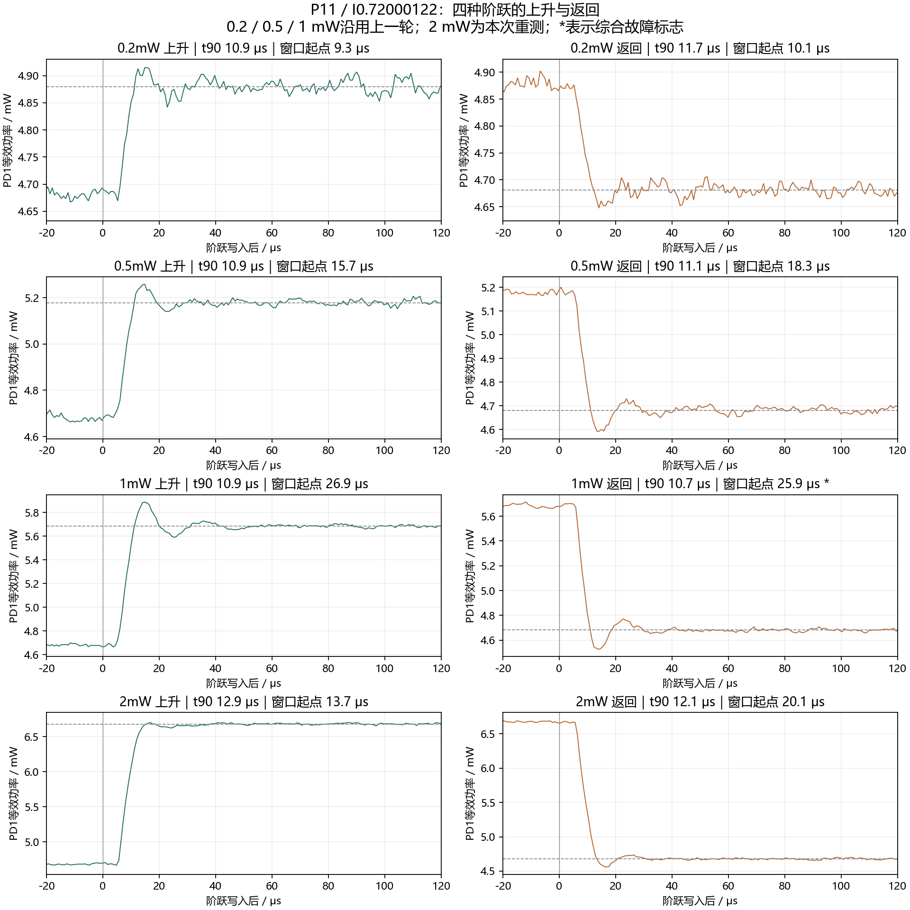
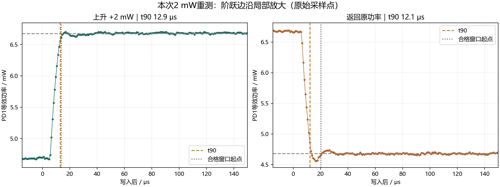
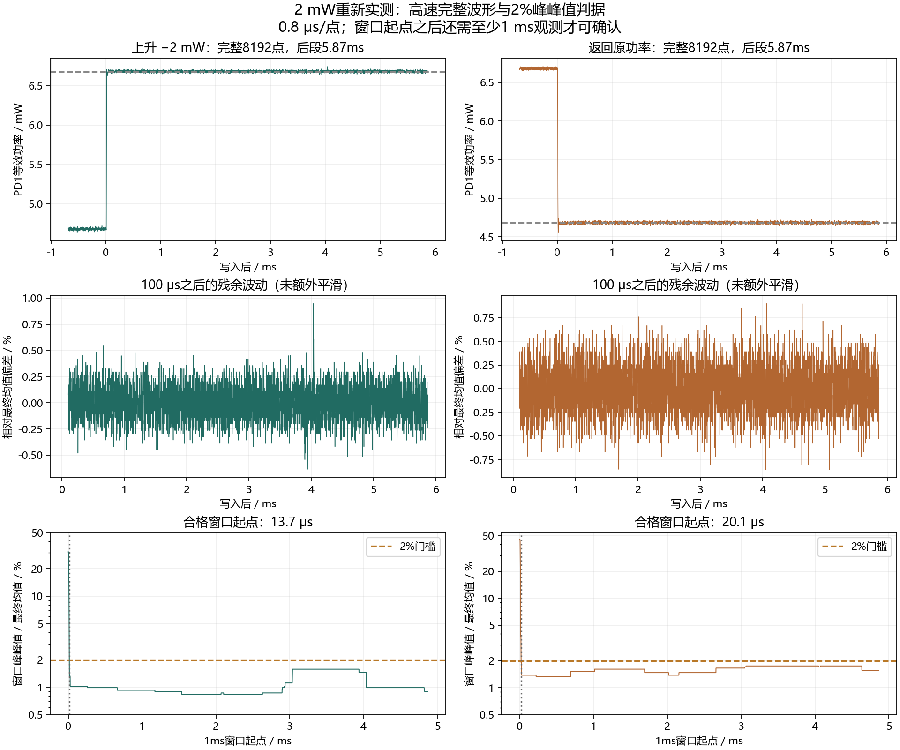
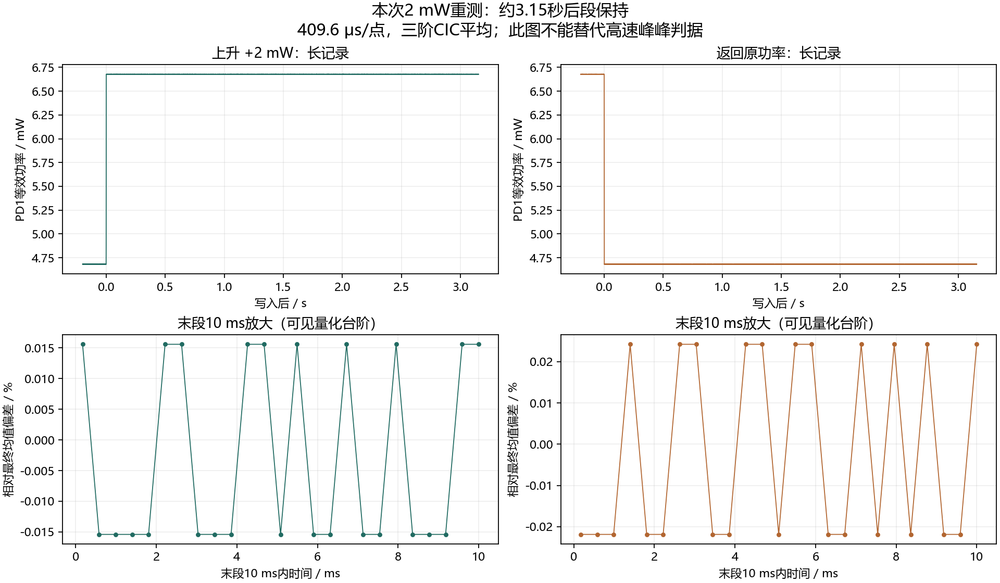
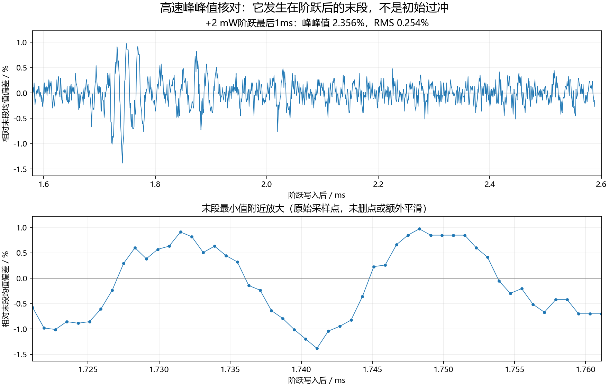
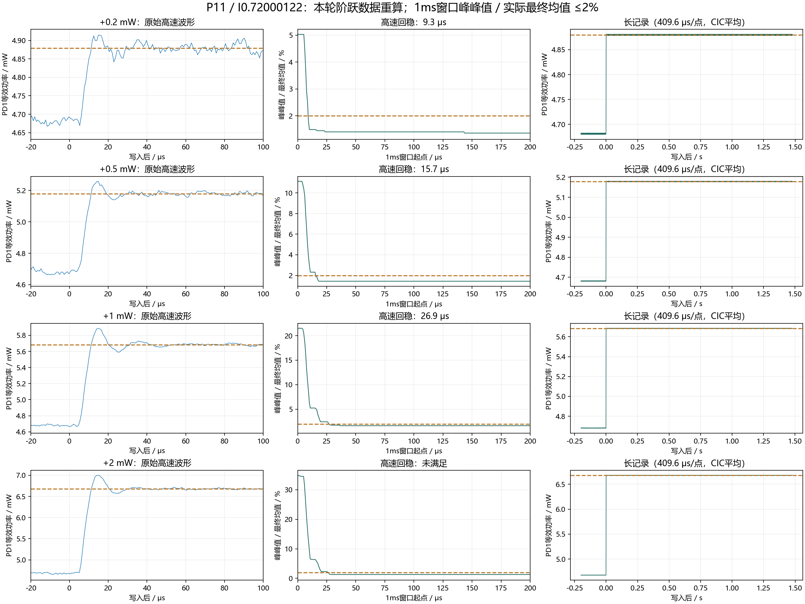
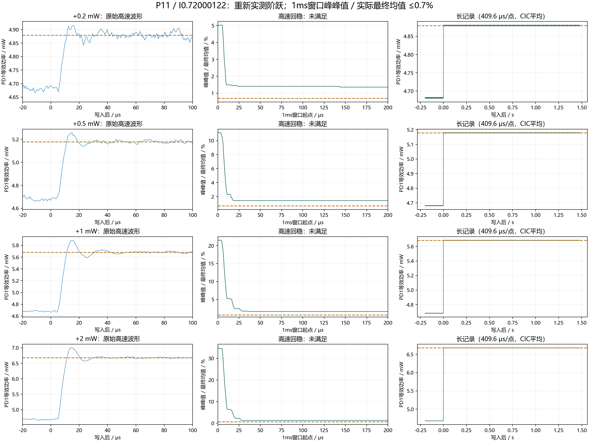
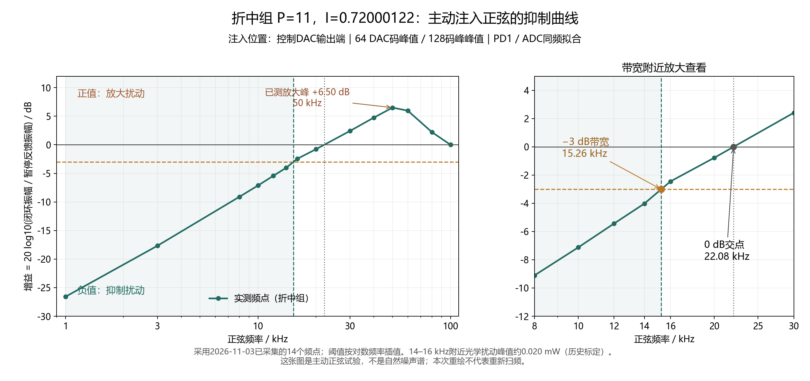
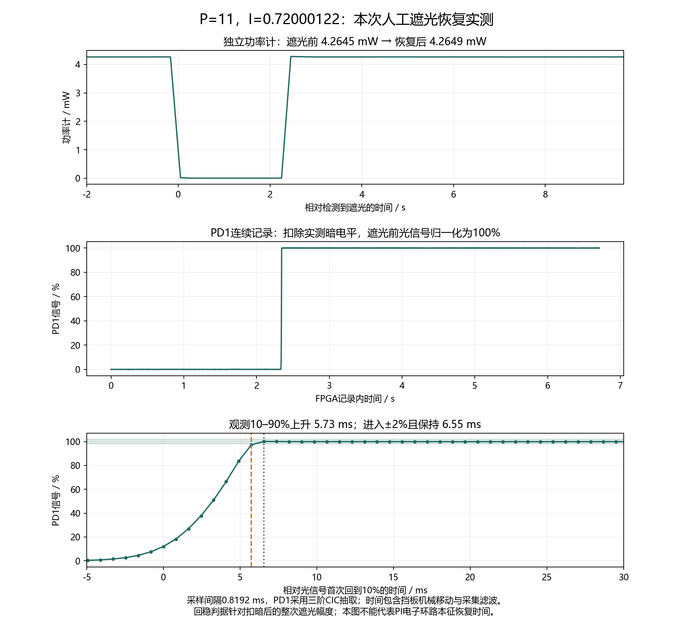

# 2026-11-03 实测折中组：P=11，I=0.720001220703125

这是用户最终选择的 **P11 折中组**，D=0，采样/控制更新率5 MHz。保留同仓库的其他历史组，当前入口为本目录。

## 代码和运行参数

- [FPGA完整RTL](../pid_fast_c07_20261029/rtl)、[PI算法](../pid_fast_c07_20261029/rtl/pi_ctrl.v)、[已实测F129固件](../pid_fast_c07_20261029/bitstream/light_lock_top.bit)。本次逐文件核对RTL、约束和bit与实际加载工程一致，SHA-256见 [firmware_reference.json](firmware_reference.json)。
- [本次P11在线配置](live_profile.json)：P寄存器0x1A=0x8B00，I寄存器0x1B=0xDC29；目标8840，偏置8198，DAC范围1400–15000，目标限速1。
- **固件上电默认仍是C07，P11是串口在线参数。** 本次上传未改变Flash或重新生成固件。不要将旧bit的上电默认与本次实测P11混为一谈。
- 安装 `pip install requests pyserial`，先运行 `python inspect_apply_profile.py` 查看当前网页控制台状态；在工作点已经匹配时，运行 `python inspect_apply_profile.py --apply` 写入并回读P11增益。脚本只改P/I，不改工作点。控制台默认地址为 http://127.0.0.1:8766，使用其已连接端口。

## 已测性能与判据

| 指标 | P11结果 |
|---|---:|
| 主动正弦−3.0103 dB带宽 | 15.26 kHz |
| 主动正弦0 dB交点 | 22.08 kHz |
| 主动正弦已采样最大放大 | +6.50 dB @ 50 kHz |
| 自然噪声持续0 dB交点 | 10.48 kHz |
| 自然噪声RMS，暂停反馈→闭环 | 0.13434% → 0.06293% |
| 同频带DC/噪声SNR | 57.44 → 64.02 dB |
| 功率计30秒相对RMS，未锁→锁定 | 0.20354% → 0.03447% |
| 本次遮光后观测10–90%上升 | 5.73 ms |
| 本次遮光后观测±2%回稳，自10%时刻计 | 6.55 ms |

正弦在DAC输出端注入64码峰值/128码峰峰值，共14频点1–100kHz；14–16kHz附近开环光功率约20μW峰值、40μW峰峰值、14μW RMS，来自历史PD1功率标定。固定DAC幅度不代表所有频率的光学幅度完全相同。增益为20log10(闭环同频振幅/暂停反馈同频振幅)，负值表示抑制。带宽在相邻频点间按对数频率插值。

自然噪声沿用本日之前的PD2 20dB实测；统一积分100Hz–100kHz。此相对RMS以照明总直流为分母，未扣暗底或电子噪声，因此不是纯激光本征噪声。相应PD2电压噪声约4.81mV RMS→2.26mV RMS；没有同次PD2绝对光功率标定，不冒充直接测得的μW。功率计30秒慢波动是另一测量口径：8.67μW RMS→1.47μW RMS。

## 最新2mW重测：往返均通过2%窗口判据

本次保持P11/I0.720001220703125，实际重测+2mW和返回，各有高速/长记录，全部8192点、捕获标志2。高速采样间隔0.8μs，阶跃后观察约5.866ms；长记录409.6μs/点，阶跃后约3.15秒。没有通过改变采样间隔拉长高速记录。

| 方向 | t90 | 2%合格窗口起点 | 最后1ms峰峰/% | 100μs后所有1ms窗口的最大峰峰/% |
|---|---:|---:|---:|---:|
| 上升+2mW | 12.9μs | 13.7μs | 0.899% | 1.581% |
| 返回 | 12.1μs | 20.1μs | 1.568% | 1.752% |

判据仍为每个跨度至少1ms的窗口内(最大−最小)/实际最终均值≤2%，并要求此后的完整窗口一直满足至记录结束。上表是窗口起点，确认需再观察至少1ms；最终均值取高速尾段1ms。t90为实际变化的90%，没有要求功率精确等于设定值。功率单位沿用历史PD1/ADC标定。

本次四条记录均无综合故障/触限捕获标志，测后恢复原F129、目标8840、P11/I0.72000122、偏置8198、限幅1400–15000与原限速1，Flash未写入。上一轮+2mW短暂波动未达标记录保留为历史，不用本次成功覆盖它。

[本次4条指标](results/steps_2mw_retest/metrics20.json) · [原始数据](results/steps_2mw_retest)

### 全部阶跃上升/返回曲线

0.2、0.5、1mW沿用上一轮，2mW来自本次重测；星号表示上一轮1mW返回有综合故障标志。

## 上一轮2%判据结果（2mW最新值见上方重测）

用户最新将门槛改为2%；对本轮同一批16条原始波形重算，未重新操作仪器，未额外平滑。这里的2%是窗口内最大−最小除以实际最终均值，不是目标值±2%，也不是阶跃幅度的2%。

每个跨度至少1ms的窗口，(最大−最小)/实际最终均值≤2%，且此后的完整窗口都满足直到记录末尾。高速最终均值取最后1ms，长记录取最后0.2s。

| 阶跃幅度 | 方向 | 高速t90 | 满足2%的窗口起点 | 最后约1ms峰峰/% |
|---|---|---:|---:|---:|
| 0.2mW | 向上 | 10.9μs | 9.3μs | 1.362% |
| 0.2mW | 返回 | 11.7μs | 10.1μs | 1.752% |
| 0.5mW | 向上 | 10.9μs | 15.7μs | 1.878% |
| 0.5mW | 返回 | 11.1μs | 18.3μs | 1.568% |
| 1mW | 向上 | 10.9μs | 26.9μs | 1.165% |
| 1mW | 返回 | 10.7μs | 25.9μs | 1.429% |
| 2mW | 向上 | 10.7μs | 记录内未满足 | 2.356% |
| 2mW | 返回 | 10.5μs | 26.5μs | 1.752% |

窗口起点不是实时确认时刻：还需至少1ms观测才能确认。+0.2mW窗口起点9.3μs可早于t90=10.9μs，因为本判据只约束窗口波动，不要求已经达到90%。这是当前明确选择的窗口波动判据，不称作标准目标误差带稳定时间。

+1/+2mW返回记录含综合故障粘滞标志10（冻结/触限/ADC OTR共用），最终实时状态已恢复；这两条返回结果须连同该标记使用。长记录经过较强CIC平均（409.6μs/点），不能代替高速结果。

### 为什么功率计很稳定，高速峰峰值仍超过2%？

功率计30秒闭环段385点，读数中位间隔78ms；RMS=0.03447%，峰峰值=0.16941%（0.00722846mW/4.26682469mW）。它证明该功率计慢速读数稳定，不证明微秒级信号没有波动。

高速PD1记录为0.8μs/点，末1ms约1251点。+2mW末段RMS=0.25394%，峰峰值=2.35584%；最大与最小分别出现在阶跃后1.7483ms和1.7411ms，属于末段波动，不是初始过冲。RMS与峰峰值不是同一统计量，峰峰值对极值敏感。

两次采集使用不同探测链路、不同采样/滤波条件，且+2mW阶跃后的工作点不同。现有数据没有分离PD1/ADC电子噪声和光学噪声，不能把2.356%全部归因于激光。也未由78ms读取间隔推断功率计内部精确带宽或平均时间。

[原始统计核对](results/steps_stability07/meter_fast_comparison.json) · [最新16条指标](results/steps_stability07/metrics20.json)

+2mW在约1.74ms附近有短暂波动，之后直到2.59ms记录末尾仅约0.84ms，不足以再确认一个完整1ms合格窗口。因此“记录内未满足”不能解释成长期持续有2.356%的波动。

## 先前0.7%判据（保留对照，当前门槛为2%）

这是用户在本次发布前最后确认的判据，并已重新采集16条波形。无需等于设定功率；t90按实际最终变化计算。

每个滑动窗口跨度至少1ms，取(最大−最小)/实际最终均值。回稳时刻为此后所有完整窗口直到记录末尾都满足≤0.7%的第一个窗口起点。最终均值取高速记录最后1ms，长记录最后0.2s。窗口完成后才可确认，确认延迟至少1ms。

| 向上阶跃 | 高速t90 | 高速0.7%回稳 | 最后约1ms峰峰值/最终均值 |
|---|---:|---|---:|
| +0.2mW | 10.9μs | 记录内未满足 | 1.362% |
| +0.5mW | 10.9μs | 记录内未满足 | 1.878% |
| +1mW | 10.9μs | 记录内未满足 | 1.165% |
| +2mW | 10.7μs | 记录内未满足 | 2.356% |

**8条高速波形（含返回）均未满足0.7%峰峰判据**。这意味着该组在当前高速测量口径下未达标，不能报一个通过的稳定时间。高速0.8μs/点，阶跃后约2.59ms；此处未另外平滑波形。

8条长记录满足窗口判据，向上阶跃对应窗口起点0.379/0.663/0.711/0.725ms，但长记录每409.6μs才输出一个经CIC平均的采样点，窗口实际跨度1.2288ms。这是平均后波形的低频稳定性，不是高速原始波形的达标证据，也不应拿这些亚毫秒数字当高精度电子恢复时间。

+1/+2mW返回的快速及长记录捕获标志为10（完成+综合故障粘滞位）。该位合并冻结、输出触限、ADC OTR，现有记录无法独立区分；最终实时状态为2、闭环恢复。其余捕获标志2。

[全部16条结果](results/steps_stability07/metrics.json) · [原始波形与记录](results/steps_stability07)

## 先前2%阶跃幅度判据（历史对照，当前采用上面的2%峰峰判据）

之前用最终总功率±2%导致小阶跃“稳定时间”早于t90，该列已撤回。现为目标±2%阶跃幅度，使用未额外平滑的高速记录，进入后直到记录末尾不再越界，至少保持1ms。

| 阶跃 | t90 | 新判据稳定时间 |
|---|---:|---:|
| +0.2mW | 11.5μs | 记录内未满足 |
| +0.5mW | 11.3μs | 记录内未满足 |
| +1mW | 11.5μs | 记录内未满足 |
| +2mW | 11.5μs | 28.3μs |

高速采样间隔0.8μs、阶跃后窗口约2.588ms。“未满足”是窄容差带内仍有越界，不代表无穷恢复时间。长时间抽取记录不能替代高速原始波形。功率步长来自历史ADC标定。

## 本次遮光恢复

实际检测到遮光后记录约2.34秒暗段并捕获移开挡板后的恢复，PD1共8192点，0.8192ms/点，三阶CIC抽取。光信号扣除实测暗电平，回稳带为遮光前ADC±2%(遮光前ADC−暗ADC)，保持到记录末尾约4.36秒。

功率计遮光前4.264513mW，恢复后4.264880mW，均值差+0.0086%；暗态最低0.000968mW。遮光期间DAC达到15000；恢复后实时状态字2，ADC8840，闭环继续工作。

上述毫秒时间含人工挡板运动与采集滤波（CIC群延迟约1.23ms），不是PI电子环路本征恢复时间。采集标志10是完成+遮光期间粘滞故障记录，最终实时状态正常，不能将该标志误报为恢复失败。

## 数据与可复现性

`results/`含修正后的16条阶跃统计及原始波形、14频点拟合记录、自然噪声平均谱和各次RMS、30秒功率计原始记录、慢扰动补偿、这次遮光恢复PD1原始数据与功率计/UART记录。
`measurement_scripts/`保存实验现场脚本（含本机仪器和路径依赖，非通用即装即用软件）；`reproduce_recovery.py`可直接从本目录原始数据重算遮光指标。
历史RTL验证与构建报告在同仓库F129目录，源码与bit本次逐文件一致；没有将历史仿真宣称为本日重新执行。
