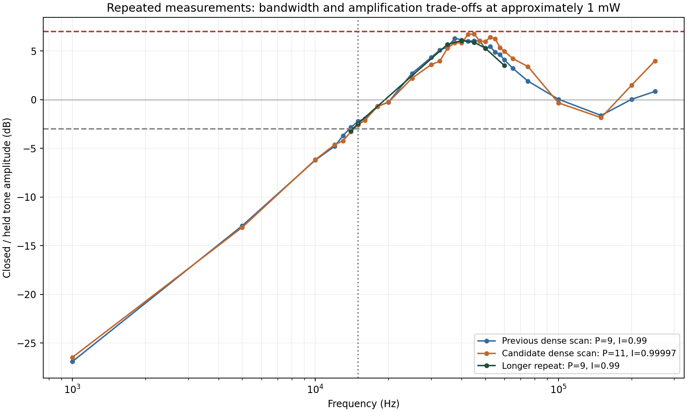

# F511 精简版与已确认 PI 参数（2026-11-06）

用户已确认采用 **P=9、I=0.989990234375（约 0.99）** 并授权上传。此目录独立保存源码、已测固件、运行参数、测试与原始数据；原工程目录保持原样。

## 采用的配置

| 项目 | 数值 |
| --- | --- |
| 比例 P | 9；寄存器 `0x1A = 35072` |
| 积分 I | 32440 / 32768 = 0.989990234375；`0x1B = 65208` |
| 采样率 | 5 MHz；I 为每个有效采样的离散增益 |
| 本次工作点 | 主光路约 1 mW；目标 ADC 8414，偏置 DAC 10000 |
| 实测单调分支输出范围 | DAC 545–13000；固件硬限幅仍为 545–15851 |
| 反馈 | 方向 1、通道 0；实际为 PI，无 D 项 |

参数文件为 [runtime_profile_1mw.json](runtime_profile_1mw.json)。**这是运行时参数：仅加载 bit 不会自动采用 I≈0.99。** 已测 bit 保留原复位默认 P=9、I≈0.5400085、目标 ADC 8476、偏置 8198；运行参数断电后需要重新设置。本次未写 Flash。

## 实测结果与适用范围

- P=9 / I≈0.99：30 点、1–250 kHz 注入测试的 −3 dB 交点约 **13.81 kHz**，已测最大放大 **+6.30 dB**；后续 7 个关键频点长记录复测交点约 **14.27 kHz**、该网格内最大 **+6.07 dB**。两次网格不同，后者不代表全频段最大值。
- 扩大搜索 15 组不同 P/I，并对候选交替测噪后，未证实整体噪声可可靠改善，故保留用户确认的参数。
- 已测试 0.3 / 0.6 / 1 mW 目标切换、关断与恢复；压噪带宽资格仅限约 1 mW 工作点。当前光路实测可用最大功率约 1.44 mW，**0–15 mW 全范围尚未验收**。
- 测量为 FPGA 环内 ADC 与 PM100USB 慢功率读数；未验证独立光学 RIN。250 kHz 以上仅有零散点，750 kHz 注入信号未可靠分辨，不能据此作全频段结论。
- 历史 OTR 位在加载后的首快照已置位，原版仅复位清除；触发原因尚未确定。波形采集另查实时 fault / clipping。详见 [第二轮报告](ROUND2_RESULT.txt)。



## 代码与构建

- `candidate/`：独立精简 F511；修改寄存器写入与读回选择的综合表达，保留原行为。保留目标在线修改、主光路功率显示、在线 PI、新 DAC 范围、关断恢复、采集及通信；ARTIQ 模拟设定值只预留接口。
- `baseline_f511/`：指定历史提交的 46 个原文件，配套 SHA-256 校验，保持原样。
- `host/`：参数应用、测量、分析与离线测试；分析脚本可生成新报告，历史报告保留测量当时的“未上传”等状态描述。
- `results/`：原始波形、寄存器回读、扫频、噪声与功能测试证据。

LUT **4461 → 4374**，FF **2652 → 2587**；DSP 14 不变。实际 Vivado 2023.2 布线结果 WNS **+0.904 ns**、WHS **+0.058 ns**，TNS/THS 为 0。9 项 RTL 仿真通过，其中寄存器等价检查 20,713 次；主机 5 项离线测试通过。

已测 RAM 固件：[light_lock_top.bit](candidate/bitstream/light_lock_top.bit)。SHA-256：

```text
7de88b9d4c14b21f543121ba436ed0a6efa04b66e22f19478a140f27ac4746c9
```

同时归档 MCS；其存在不表示已烧写或本次需要烧写 Flash。`candidate/boot_profile.json` 描述复位默认值，采用参数以顶层 `runtime_profile_1mw.json` 为准。

## 校验与使用

在本目录运行（以下三个命令不操作硬件）：

```powershell
python -B verify_workspace.py
python -B -m unittest discover -s host -p test_bench.py
python -B candidate/scripts/verify.py
```

RTL 工具路径沿用本机 `D:/Xilinx/Vivado/2023.2/bin`。完整构建命令：`python -B candidate/scripts/run_build.py`。

现场脚本使用 COM9、JTAG 210512180081、PM100USB P2007293 / 556 nm，以及现有控制台 `http://127.0.0.1:8766`。控制台所在目录为 `D:/DSproject/workbench/sites/mot556-console`，标定读取其中 `data/calibration.json`。所需 Python 包列于 `requirements.txt`。这些脚本依赖该现场配置，不是跨设备自动识别安装包；已有上位机与功率计大屏继续使用。`measurement_calibration_snapshot.json` 保存本次使用的历史标定供数据追溯，不自动覆盖现场标定。

**已经在匹配工作点闭环时**，应用已确认参数并检查 15 秒：

```powershell
python -B host/apply_profile.py runtime_profile_1mw.json
```

脚本核对固件、采样率、目标和输出范围；失败时恢复原 P/I。串口必须独占；功率计通过现有控制台读取，勿另开竞争会话。

**从重新加载 RAM 后恢复本次工作点时**，依次运行下列命令；每一步成功后再继续。这会实际操作硬件，须保持与本次相同的光路、标定和设备：

```powershell
python -B host/deploy_ram.py
python -B host/lock_target.py --power-mw 1.0 --bias 10000 --kp 2 --ki 0.12
python -B host/apply_profile.py runtime_profile_1mw.json
```

`deploy_ram.py` 完成后置于固定输出；`lock_target.py` 仅从固定输出建立已测低功率工作点；最终应用 P=9 / I≈0.99。原 `preflight_read.py` 是早期直接读功率计工具，在控制台占用功率计时不要运行；当前只读核对可用 `round2_preflight.py`。

基线来源：[指定 F511 历史提交](https://github.com/soyotoanon/20261022-vco-mapping-verification/tree/dbd82b81c37a0ecfdc101d2257ec997aab8e0bce/pid_setpoint_direct_f511_20261105)。原始目录在仓库 main 上已更名为 `pid_dac_pm5v_20261105`，本次不改该目录。
